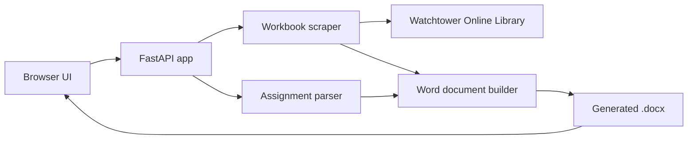

# Meeting Workbook Generator

A FastAPI web app that turns Watchtower Online Library meeting workbook pages into formatted Word schedules.

Select a month, paste or upload the assignment list, and download a `.docx` schedule with the meeting sections, dates, parts, and assigned names already laid out.

## Features

- Fetches the current meeting workbook index from `wol.jw.org`.
- Parses each week's meeting content in parallel with `asyncio.gather`.
- Extracts part numbers, titles, and time durations.
- Builds Word tables with section colours and three- or four-column layouts.
- Fills in assignment names from pasted text or an uploaded file.
- Supports skipping weeks marked as regional convention weeks.
- Includes English and Yoruba workbook paths.
- Provides a browser UI served directly by FastAPI.
- Streams the generated document back as a download.
- Exposes a health check for deployment monitoring.

## Architecture



The scraper and document builder live in `main.py`. `index.html` contains the browser interface. `web_scrapper.py` is an earlier standalone scraper used as a reference during development.

## Tech stack

| Area | Technology |
| --- | --- |
| Language | Python 3.13 |
| Framework | FastAPI |
| HTTP client | aiohttp |
| HTML parsing | BeautifulSoup |
| Document generation | python-docx |
| Server | Uvicorn |
| Packaging | uv |
| Debugging | icecream |

## Project structure

```text
main.py                    FastAPI app, scraper, parser, and DOCX builder
web_scrapper.py            Standalone scraper used during development
index.html                 Browser interface
assignments_for_may.txt    Example assignment input
GeneratedDocs/             Example generated schedules
pyproject.toml             Dependencies and project metadata
```

## Getting started

### Prerequisites

- Python 3.13
- [uv](https://docs.astral.sh/uv/)

### Run locally

```bash
git clone https://github.com/TechBroAdedara/Meeting-Workbook-Generator.git
cd Meeting-Workbook-Generator
uv sync
uv run uvicorn main:app --reload
```

Open `http://127.0.0.1:8000`.

### Using the app

1. Choose a month.
2. Choose English or Yoruba.
3. Paste the assignment list or upload a text file.
4. Generate the schedule.
5. Download the generated `.docx`.

The browser calls `POST /generate` and receives the document as a streaming response.

## Assignment input

Assignments are grouped by date. A date line starts a new week, and each `(number)` line maps a meeting part to a person.

```text
MAY 2026

04/05/2026
(3) B.R...Bassey Ubong
(4) S.C...Tracy Abieba/Elizabeth Odu
(5) S.C...Mary Igboin/Victoria Ayantoye
(6) Talk.... Michael Nwoko

18/05/2026
WEEK OF REGIONAL CONVENTION

25/05/2026
(3) B.R....Goodnews Ojekere
(4) S.C...Rosemary Idowu/Kemi Oyegbile
```

A line containing `WEEK OF` marks the current week as a convention week and skips assignment matching for that week. See `assignments_for_may.txt` for a complete example.

## API

| Method | Endpoint | Description |
| --- | --- | --- |
| `GET` | `/` | Browser interface |
| `POST` | `/generate` | Generate and download a schedule |
| `GET` | `/health` | Health check |

`POST /generate` accepts `multipart/form-data` with:

| Field | Required | Description |
| --- | --- | --- |
| `month` | Yes | Month slug, for example `may` |
| `language` | No | `english` or `yoruba`; defaults to `english` |
| `assignments` | No | Assignment text |
| `assignments_file` | No | Assignment text file; overrides `assignments` when provided |

The response is a `.docx` file with a `Content-Disposition` attachment header.

## Configuration

Workbook URLs, valid months, section colours, and language-specific patterns are defined in `LANGUAGE_CONFIG` in `main.py`.

The current paths target the **2026** meeting workbook. When a new workbook year is published, update the `workbook_path` values in `LANGUAGE_CONFIG`.

Scraping depends on the current HTML structure of the Watchtower Online Library. If the site markup changes, the selectors in the scraper will need to be updated.

## Examples

`GeneratedDocs/` contains sample schedules generated by the app.

## Contact

- Portfolio: [adedara-adeloro.cv](https://adedara-adeloro.cv)
- LinkedIn: [adedara-adeloro](https://www.linkedin.com/in/adedara-adeloro-813b9424b/)
- Email: [courageadedara@gmail.com](mailto:courageadedara@gmail.com)
